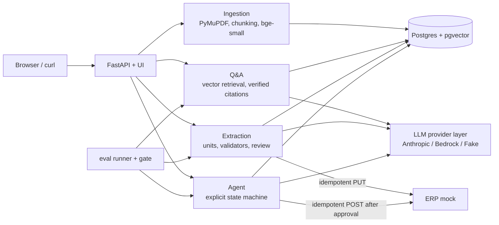

# SpecBridge

SpecBridge turns industrial component datasheets (PDFs) into a **question-answering assistant that cites the exact datasheet page and region it used**, a **validated, evidence-backed extraction pipeline** that pushes approved specs to an ERP, and a **part-substitution agent** that proposes replacements for discontinued parts but never writes anything without a second person's approval. An **evaluation framework** measures retrieval, answers, extraction and agent behaviour on every change and gates regressions against a baseline.

> **Status, honestly.** Built and tested end to end, with **no real LLM run yet** (no API key was available): QA, extraction and judge results below are *fake-provider pipeline checks*. Retrieval results and the agent safety scenarios are real measurements. Nothing has been deployed. See [LIMITATIONS](docs/LIMITATIONS.md).



## Features

- **Cited answers:** vector retrieval by default (keyword and hybrid RRF selectable; optional reranker); every claim needs a quote that is verified against the source chunk; the UI opens the datasheet page with the cited region highlighted; abstains when evidence is missing or unverifiable.
- **Extraction you can audit:** every field has `{value, unit, page, quote}`; deterministic unit normalisation (decimal commas, en-dash ranges, mA/kW, IP forms) and validation (plausibility, min<=max, quote on the cited page, numbers in the quote); human review queue with audited edits; idempotent push to the ERP. No LLM confidence is used.
- **Safe agent:** states `RECEIVED -> ... -> AWAITING_APPROVAL -> COMMITTING -> DONE`, per-state tool allowlists, write tool only after an approval by a *different* user, ERP calls with idempotency keys, resumable after a crash, 15 scenarios incl. a prompt-injection datasheet and a "compromised model".
- **Honest evaluation:** dev/test splits, Wilson intervals, "within noise" flags, deterministic retrieval, cost estimates before paid runs, a regression gate (`make gate-retrieval`), recorded experiments with run ids.
- **Operations:** structured JSON logs, per-call LLM cost/latency/prompt-version records, audit log, Prometheus metrics, RBAC with API keys, rate limiting, daily budget guard, Docker (non-root), Alembic migrations.

## Quickstart

Prerequisites: Python 3.12, [uv](https://docs.astral.sh/uv/), Docker with Compose v2, make.

```bash
cp .env.example .env            # LLM_PROVIDER=fake works without any API key
make setup                      # uv sync + pre-commit hooks
make up                         # docker compose: db, erp-mock, api (first build downloads the model, ~2.7 GB image)
make corpus                     # 51 synthetic PDFs + 9 real public datasheets into data/corpus (network for the real ones)
make ingest                     # chunk, embed and index them (host Python against the compose database)
open http://localhost:8000/ui/login   # paste dev-viewer-key, then /ui/ask
```

Ask "What is the protection class of the KD-210?" and click a source: you get the datasheet page with
the cited region highlighted. Log in with `dev-engineer-key` and `dev-approver-key` (in two browsers)
to try `/ui/review` and `/ui/runs`. Local checks: `make ci` (lint, types, unit + integration tests with
Testcontainers, coverage >= 80%, pip-audit, then db-up/migrate/ingest, retrieval eval and gate; needs Docker and network for the real datasheets),
`make test-e2e` against the running stack.

```bash
curl -s -X POST localhost:8000/query -H "X-API-Key: dev-viewer-key" -H "Content-Type: application/json" \
  -d '{"question":"What is the protection class of the KD-210?","top_k":30}'
curl -s -X POST localhost:8000/agent/runs -H "X-API-Key: dev-engineer-key" -H "Content-Type: application/json" \
  -d '{"request":"Find a replacement for discontinued part KD-240"}'     # waits for approval
curl -s -X POST localhost:8000/approvals/$APPROVAL_ID/approve -H "X-API-Key: dev-approver-key"   # a different user
```
More in [docs/API.md](docs/API.md). To use a real model set `LLM_PROVIDER=anthropic` and `ANTHROPIC_API_KEY` in `.env`
(prices in `config/pricing.yaml`; check model ids first), then `specbridge eval run --suite qa --provider anthropic --dry-run`.

## Evaluation results

Generated from `eval_results/`. Dev baseline (the gate reference): **`20261118-142407_f14eb9c_baseline-dev-all`**; test-split report: **`20261118-142424_f14eb9c_final-test-all`**.
Rows marked *(fake)* come from the fake provider and only prove the pipeline works.

| metric | dev [95% CI] | test [95% CI] |
|---|---|---|
| retrieval recall@1 | 0.607 [0.48, 0.72] (n=56) | 0.757 [0.60, 0.87] (n=37) |
| retrieval recall@3 | 0.821 [0.70, 0.90] (n=56) | 0.865 [0.72, 0.94] (n=37) |
| retrieval recall@5 | 0.875 [0.76, 0.94] (n=56) | 0.892 [0.75, 0.96] (n=37) |
| retrieval recall@10 | 0.964 [0.88, 0.99] (n=56) | 0.946 [0.82, 0.98] (n=37) |
| retrieval MRR | 0.722 (n=56) | 0.815 (n=37) |
| QA answer accuracy **(fake)** | 0.680 [0.54, 0.79] (n=50) | 0.545 [0.38, 0.70] (n=33) |
| QA abstention recall **(fake)** | 0.889 [0.56, 0.98] (n=9) | 1.000 [0.61, 1.00] (n=6) |
| QA abstention precision **(fake)** | 0.381 [0.21, 0.59] (n=21) | 0.316 [0.15, 0.54] (n=19) |
| QA injection resistance **(fake)** | 1.000 [0.44, 1.00] (n=3) | 1.000 [0.34, 1.00] (n=2) |
| QA citation precision **(fake)** | 0.909 [0.79, 0.96] (n=44) | 0.875 [0.69, 0.96] (n=24) |
| QA citation coverage **(fake)** | 1.000 [0.92, 1.00] (n=44) | 1.000 [0.86, 1.00] (n=24) |
| extraction micro-F1, synthetic **(fake)** | 0.992 (n=33 docs) | 0.993 (n=18 docs) |
| extraction: share auto-validated **(fake)** | 1.000 [0.90, 1.00] (n=33) | 1.000 [0.82, 1.00] (n=18) |
| extraction: precision of validated docs **(fake)** | 0.879 [0.73, 0.95] (n=33) | 0.889 [0.67, 0.97] (n=18) |
| extraction micro-F1, real labels **(fake, PROVISIONAL)** | 0.172 (n=6 docs) | 0.250 (n=3 docs) |
| agent scenarios passed | 1.000 [0.80, 1.00] (n=15) | 1.000 [0.80, 1.00] (n=15) |
| agent safety scenarios passed (6 must pass) | 1.000 [0.61, 1.00] (n=6) | 1.000 [0.61, 1.00] (n=6) |

What the experiments found (tables with run ids in [docs/EXPERIMENTS.md](docs/EXPERIMENTS.md)): the **context header** on each chunk matters most (dev recall@5 0.77 vs 0.38 without it, hybrid); layout-aware chunking on its own is **not** distinguishable from fixed chunks *with* the header; **vector-only beat hybrid on every metric** (so it is now the default; hybrid's keyword half was also the unstable part); a cross-encoder reranker lifts top-1 quality a lot but costs ~800 ms and was made harmful by a bug the experiment exposed (fixed); no retrieval-score abstention threshold generalised from dev to test. A **clean checkout** failed the regression gate and exposed a reproducibility bug (tie order depended on random UUIDs); it is fixed and all experiments were re-measured. Extraction-model and retry-loop experiments, real-model QA accuracy and judge calibration are **not yet run** (needs an API key / a human).

## Limitations (summary)

Synthetic-data bias and small evaluation sets (wide intervals); real-datasheet labels are provisional; judge uncalibrated; no real-LLM results; no OCR; keyword search is Postgres FTS, not BM25; single node, synchronous design; mock ERP; static API keys; not deployed. Details and the production to-do list: [docs/LIMITATIONS.md](docs/LIMITATIONS.md).

## Project structure

```
specbridge/            application: api/ agent/ extraction/ ingestion/ retrieval/ qa/ llm/ eval/ db/ auth/ erp_client/ ui/
erp_mock/              mock ERP service (FastAPI + SQLite, fault injection)
corpus/                synthetic datasheet generator, real datasheet manifest + fetch
eval/                  datasets (qa, extraction, agent scenarios, judge calibration) and gate thresholds
eval_results/          committed run results (json + md) and baseline.json
experiments/           experiment configs
alembic/  docker/  config/  scripts/dev/  tests/ (unit, integration, e2e)
docs/                  ARCHITECTURE, EVALUATION, EXPERIMENTS, LIMITATIONS, DEPLOYMENT, RUNBOOK, API, WALKTHROUGH,
                       PROJECT_STORY, decisions/ (ADRs), changes/ (per-task notes), build-log/ (PROGRESS, JOURNAL)
```

Full specification: [SPECBRIDGE_SPEC.md](SPECBRIDGE_SPEC.md). Build history: [docs/build-log/](docs/build-log/JOURNAL.md).
