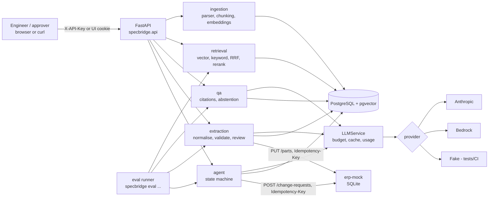
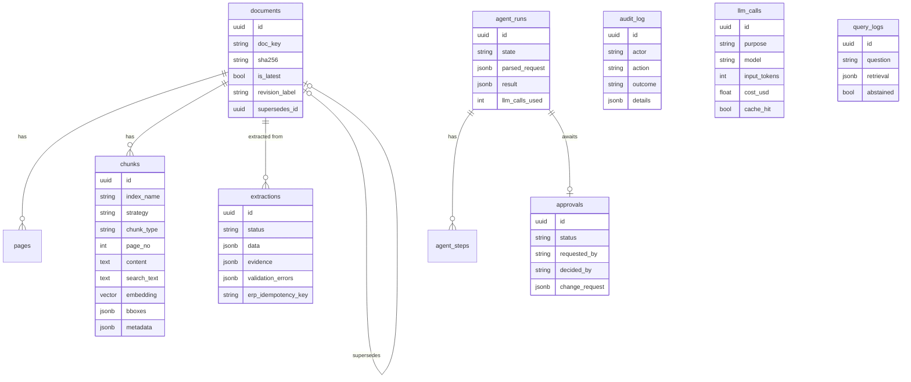
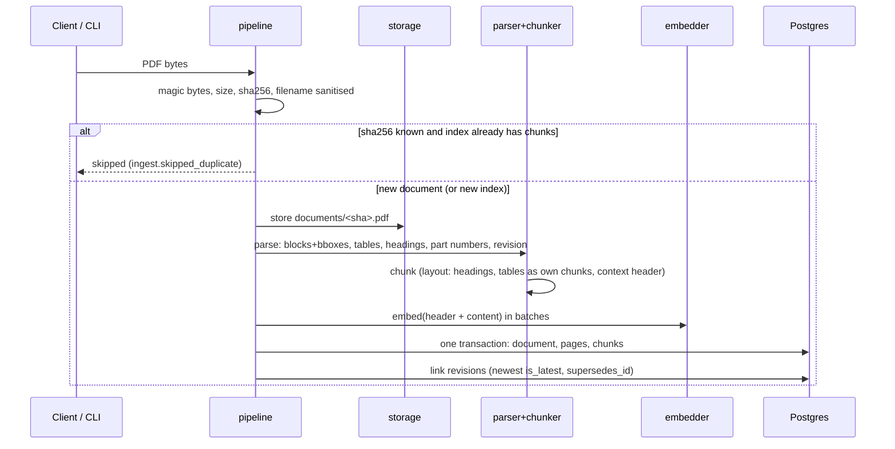
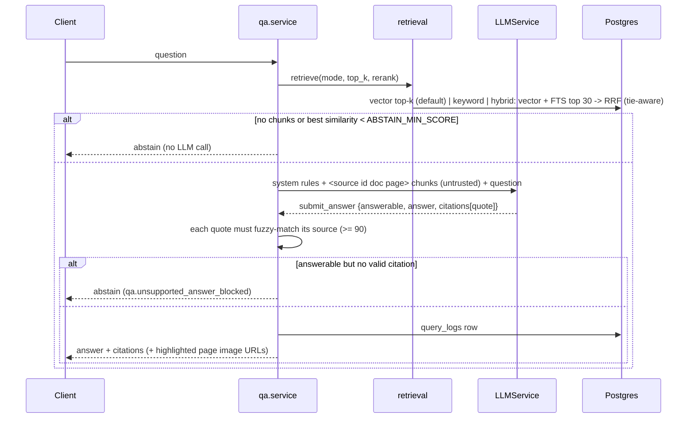
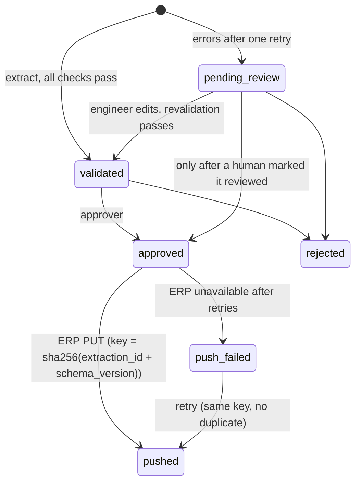
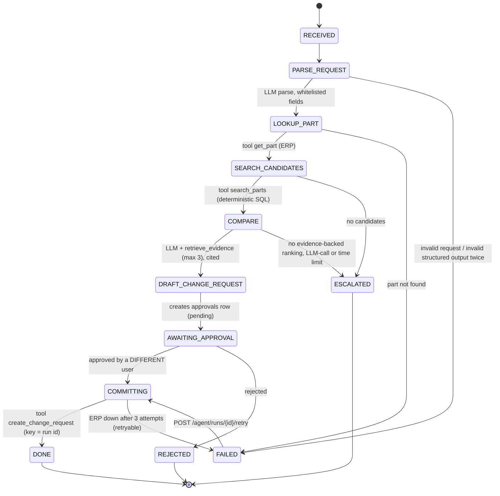
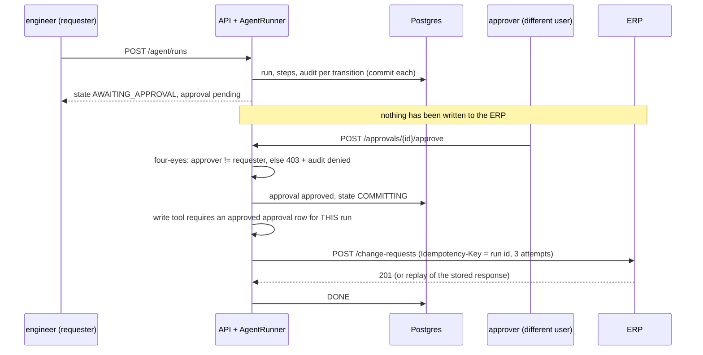

# Architecture

SpecBridge is one FastAPI service (`specbridge/`), one PostgreSQL+pgvector database, and a separate
mock ERP service (`erp_mock/`). All LLM access goes through one provider layer.

## Modules

| module | responsibility |
|---|---|
| `config.py`, `logging_setup.py`, `metrics.py`, `errors.py` | pydantic-settings (fail fast), structlog JSON logging with redaction, Prometheus metrics, error types mapped to `{"error": {code, message, request_id}}` |
| `db/` | SQLAlchemy models (Section 6 of the spec), sessions, Alembic migration `0001`, ephemeral databases for hermetic evals |
| `llm/` | provider protocol, Anthropic/Bedrock/Fake providers, pricing from `config/pricing.yaml`, budget guard, response cache, usage accounting, forced-tool structured output |
| `ingestion/` | PDF validation, PyMuPDF parser (blocks, tables, headings), `fixed` and `layout` chunking, embeddings, idempotent pipeline, revision linking |
| `retrieval/` | `vector` (default), `keyword`, `hybrid` (RRF k=60, tie-aware ranks), optional cross-encoder rerank; deterministic tie-breaks |
| `qa/` | prompt, untrusted-source wrapping, citation verification, abstention |
| `extraction/` | schema, units, normalisation, validators, extractor with retry, review/approve/push, eval suite |
| `erp_client/` | httpx client with retries and idempotency keys |
| `agent/` | states, permissions, tools, runner, scenario engine, eval suite |
| `auth/`, `audit.py` | API keys, RBAC matrix, append-only audit log |
| `api/` | routers (`health`, `documents`, `query`, `extractions`, `agent`, `audit`, `ui`), middleware (request id, rate limit), dependencies |
| `eval/` | datasets, metrics, stats, runner, compare, gate, judge, calibration, experiments |

## Data model

Notes: `chunks.search_text` (context header + content) feeds the embedding and a generated
`content_tsv` (`simple` config); `chunks.content` stays clean for citations. `chunks.index_name`
lets several chunkings coexist. `storage_path` is relative to `DATA_DIR`.

## Data flows

### Ingestion

A failure marks the document `failed` and the directory run continues with the next file.

### Question answering

### Extraction, review and push

The LLM (`submit_spec` forced tool) returns `{value, unit, page, quote}` per field. Normalisation and
validation are deterministic (ADR-0005); there is no confidence score anywhere.

### Part-substitution agent

## Security design

- **Prompt injection.** Document text is data: wrapped as `<source>`, `<page>`, `<candidates>` tags with
  closing-tag escaping, system rules say never to obey it, answers need verified citations, and the
  agent's safety is code, not prompt: per-state tool allowlists (the write tool exists only in
  `COMMITTING`), a write guard that queries for an approved approval row, a four-eyes rule, and
  document text can never cause a state transition. The corpus contains an injection datasheet
  (`AL-DIO-199`); scenarios S10 and S12 script a model that obeys it and show the write is denied and
  nothing is sent to the ERP.
- **No LLM-generated SQL.** `search_parts` builds a parameterised SQLAlchemy query from whitelisted,
  Pydantic-validated constraint fields. Query filters on the API are whitelisted.
- **AuthN/Z.** `X-API-Key` compared with `hmac.compare_digest`; RBAC matrix (viewer, engineer,
  approver, admin) enforced by a dependency; every denial is audited in its own transaction so a
  request rollback cannot lose it. The `audit_log` has no update or delete code path.
- **Input validation.** PDF magic bytes, size limit with a bounded read, page-count cap, filename
  sanitisation, Pydantic bodies, `SameSite=Strict` HttpOnly session cookie for the UI, HTML autoescape.
- **Abuse and cost.** Per-key rate limit; daily LLM budget guard returns 503 `budget_exceeded`;
  eval runs abort above `EVAL_MAX_COST_USD`.
- **Secrets.** Environment only; `.env` is git-ignored; log values and the `X-API-Key`/`Authorization`
  headers are redacted; LLM payload logging is off in the prod compose file.
- **Containers** run as a non-root user on a slim base; `pip-audit` runs in `make ci`.

## Failure modes and how each is handled

| failure | handling |
|---|---|
| Database down | `/ready` 503 (`database: error`); requests fail with 500 `internal_error` and a request id; Docker healthcheck stays on `/health` |
| Embedding model missing | `/ready` 503 (`embedding_model: error`) |
| LLM rate limit / 5xx / timeout | tenacity exponential backoff with jitter (`LLM_MAX_RETRIES`); 4xx are not retried; every attempt is accounted |
| LLM invalid structured output | one retry with the validation error appended, then `StructuredOutputError` -> 502 (QA/extraction) or agent `FAILED` with a clear message |
| Daily budget exceeded | `BudgetExceededError` -> 503 `budget_exceeded`; `budget.exceeded` logged; agent run `FAILED` |
| Unsupported / fabricated answer | invalid citations dropped and logged; answer blocked and replaced by an abstention |
| Extraction fails validation | one retry with errors; else `pending_review` for a human |
| ERP transient failure | 3 attempts with backoff, same idempotency key; lost responses replay the stored result |
| ERP down | extraction push -> `push_failed` (retryable); agent run `FAILED` with `retryable=true`, `POST /agent/runs/{id}/retry` |
| Process crash mid-run | each transition is committed; `specbridge agent resume <run_id>` (explicit, never automatic) |
| Duplicate approval click | second decision -> 409; the approval row is locked `FOR UPDATE` |
| Malformed / hostile upload | rejected before parsing (400); a failing parse records a `failed` document and the batch continues |
| Ingestion of a moved data dir | paths are relative to `DATA_DIR`; duplicate uploads re-store a missing file |
| Rate limit exceeded | 429 `rate_limited` with `Retry-After` |
